# ha-device-card

[](https://www.home-assistant.io/integrations/marketplace/)
[](https://github.com/juju35/ha-device-card/actions/workflows/hacs.yml)
[](https://github.com/juju35/ha-device-card/actions/workflows/validate.yml)
[](https://github.com/juju35/ha-device-card/actions/workflows/lint.yml)
[](https://github.com/juju35/ha-device-card/releases/latest)
[](https://github.com/juju35/ha-device-card/blob/main/LICENSE)
[](https://buymeacoffee.com/julienstep9)

<p align="center"></p>

<p align="center">
  
</p>

Lovelace cards for Home Assistant showing the **phones, tablets and computers** that run the [Home Assistant Companion app](https://companion.home-assistant.io/) — the devices, not the people: their **battery** (level, charging, charger), when they **last reported**, their **Wi-Fi network** or **zone**, **storage**, **Focus / Do Not Disturb**, system and app versions, the extras of a **Mac**, and a **Ring device** button that makes a lost phone ring even when it is silent.

The devices and their sensors are **discovered automatically** from the Home Assistant registries (the `mobile_app` integration): no entity to list, whatever your language or entity ids.

[](https://my.home-assistant.io/redirect/marketplace_repository/?owner=juju35&repository=ha-device-card&category=plugin)

| Full card | Mini card |
|---|---|
| 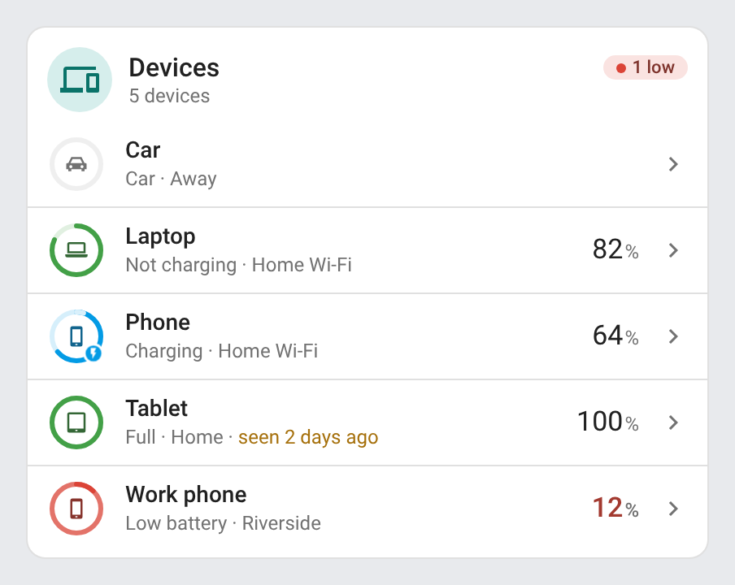 | 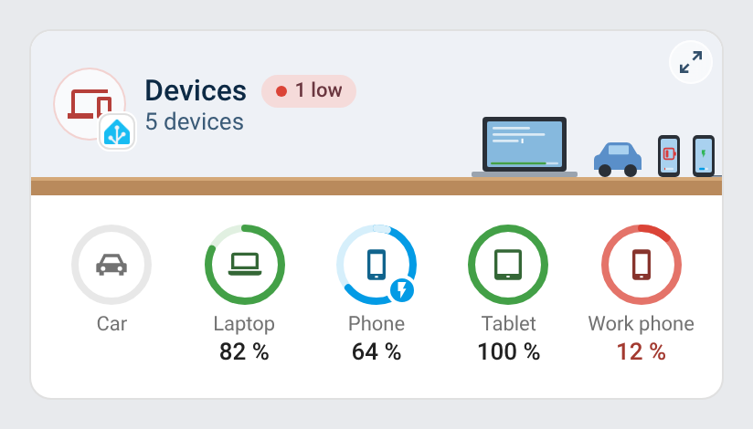 |

## Features

- Two cards: a full **Device Card** (`custom:device-card`) and a compact **Device Mini Card** (`custom:device-mini-card`)
- **Animated illustrated header** (90 px, full and mini card): the card's own devices (laptop, computer, tablet, phone, watch, car) standing on a desk, each with its state on its screen — a beating green bolt and a cable while charging, a blinking red battery when low, a dark screen when offline, else its battery level — and a window with the sun and a drifting cloud by day, the moon and stars by night (night with a dark Home Assistant theme, day with a light one; `illustration_theme` forces it)
- The header icon is in the color of the devices' state (red: a low battery, amber: a device offline, blue: charging, green: all good), with the Mobile App logo as a badge; the state also reads in a pill right after the title (**1 low**, **Charging**, **All good**)
- Classic header (`illustration: false`) with a status pill: **All good**, **1 low** (battery under `low_battery`) or **2 offline** (not reported for `stale_after` hours)
- One row per device: a small **battery ring** around the device's icon (green, blue while charging, red when low), its name, one line with the charging state, the Wi-Fi network or the zone, and **seen 2 days ago** when it stopped reporting, and the battery level on the right (red when low)
- **Animated ring**: a light runs round it with a beating bolt while charging, it pulses in red when the battery is low (see [Animations](#animations))
- Click a row to unfold its **details** inline: battery (state, charger, Low Power Mode, health, temperature, time to full), last update, location (zone and geocoded place), connection (Wi-Fi network, cellular technology and carrier), storage (free of total, in GiB), Focus, Do Not Disturb, ringer, activity, system and Companion app versions; for a **Mac**: in use or idle, locked, displays, frontmost app, camera and microphone in use
- **Ring device**: a critical notification sent to the device (heard in silent mode and through a Focus on iOS, on the alarm stream on Android, a plain notification for a third-party Windows or Linux app), after a confirmation popup at the top of the card
- Detail button on the mini card (top right): it switches the battery rings to the full list and back; a click anywhere outside the card brings the compact view back
- Unfolded devices fold back, and the popup closes without ringing, on a click elsewhere or when the card leaves the page
- Click any value to open its Home Assistant more-info dialog
- Visual editor in the dashboard UI for both cards, with a device picker limited to the Companion app devices
- Sections view: the full card takes 12 columns by default and at least 6, the mini card 6; narrow widths get their own layout
- Light and dark mode, `prefers-reduced-motion`, keyboard navigation, English, French, German, Spanish, Italian, Dutch, European Portuguese, Polish, Serbian (Cyrillic and Latin), Romanian, Danish, Swedish, Bulgarian, Russian, Ukrainian, Hungarian, Slovak, Czech, Slovenian, Latvian and Greek
- Single file, no external dependency

## Supported integrations

| Integration | What the cards read |
|---|---|
|  [Mobile App](https://www.home-assistant.io/integrations/mobile_app/) (core, `mobile_app`) — Companion app for **iOS / iPadOS**, **macOS** and **Android** (Android Automotive included) | Battery level and state, charging and charger type, battery health and temperature, remaining charge time, power save / Low Power Mode, device tracker (zone, battery level), geocoded location, SSID, connection and network type, SIM carrier, internal storage, Focus, Do Not Disturb, ringer mode, activity, OS and app versions, interactive / active, device locked, displays, frontmost app, camera and microphone in use, the `notify.mobile_app_*` service |

Many sensors of the Companion app are **off by default** (in the app's settings, **Companion App → Manage Sensors** on iOS / macOS, **Settings → Companion app → Manage sensors** on Android): turn on the ones you want, the card shows them as soon as they are there.

## Prerequisites

Home Assistant 2024.8 or later, with at least one device signed in with the Companion app. **Ring device** on iOS and macOS plays a sound in silent mode only once **critical alerts** are allowed for the Companion app (asked by the app, or in the device's notification settings).

## Installation

### Via the Marketplace (recommended)

Click the button below to add the repository directly:

[](https://my.home-assistant.io/redirect/marketplace_repository/?owner=juju35&repository=ha-device-card&category=plugin)

Then click **Install**, and reload your browser when the Marketplace asks you to.

Or manually:

1. Open **Settings → Marketplace → Add from link** (top right; this needs a GitHub account connected)
2. Add `https://github.com/juju35/ha-device-card` — Type: **Dashboard**
3. Open **Device Card** and click **Install**
4. Clear your browser cache and refresh

The Marketplace adds the resource `/local/community/ha-device-card/device-card.js` for you.

### Manual

1. Download `device-card.js` and the `device-card.i18n.*.js` translation files from the [latest release](https://github.com/juju35/ha-device-card/releases/latest)
2. Copy them all to `/config/www/` (without the translation files, the cards show in English)
3. Go to **Settings → Dashboards → ⋮ → Resources** → Add resource:
   - URL: `/local/device-card.js`
   - Type: **JavaScript Module**
4. Clear your browser cache and refresh

## Configuration

### Card types

| Card | Type |
|---|---|
| Device Card | `custom:device-card` |
| Device Mini Card | `custom:device-mini-card` |

### Visual editor

Edit a dashboard, click **Add card** and search for **Device Card** or **Device Mini Card**. Every Companion app device is shown by default; pick some devices in the list (or leave some out), set an optional title, choose what the details show, the sort order, the low battery level, the hours after which a device reads offline, the ring message and the language. The preview updates live, and options left at their default are kept out of the generated YAML.

### Minimal

```yaml
type: custom:device-card
```

```yaml
type: custom:device-mini-card
```

### Full options

```yaml
type: custom:device-card
devices:
  - Phone
  - device: Work phone
    name: Work
    kind: phone
    notify: mobile_app_work_phone
    entities:
      battery: sensor.work_phone_battery_level
  - 0a1b2c3d4e5f60718293a4b5c6d7e8f9
title: Our devices
illustration: true
illustration_theme: auto
show_title: true
show_subtitle: true
show_location: true
show_connection: true
show_storage: true
show_status: true
show_system: true
show_computer: true
show_actions: true
sort: battery
details: collapsed
low_battery: 15
stale_after: 24
ring_message: Here I am!
language: fr
```

```yaml
type: custom:device-mini-card
exclude:
  - Car
show_names: true
zoom: true
sort: battery
```

### Options reference

| Option | Card | Default | Description |
|---|---|---|---|
| `devices` | both | All | Devices to show, in this order with `sort: none`: device names (as shown in Home Assistant) or device ids (set by the visual editor). An item can also be an object with per-device options — `device` (name or id), `name`, `kind` (`phone`, `tablet`, `laptop`, `desktop`, `car`, `watch`, `other`: the icon), `notify` (the notify service used to ring it) and `entities` (see [Entities](#entities)); such a list is **YAML only** |
| `exclude` | both | — | Devices left out when `devices` is not set (names or ids) |
| `title` | both | Devices | Card title |
| `illustration` | both | `true` | Animated illustrated header (devices on a desk); `false` for the classic header with its status pill |
| `illustration_theme` | both | `auto` | `auto` (follows the Home Assistant theme: night with a dark theme, day with a light theme), `day` or `night` |
| `show_title` | both | `true` | Show the title in the header |
| `show_subtitle` | both | `true` | Show the number of devices under the title (for a single device: its name, model and system) |
| `show_location` | both | `true` | Zone or geocoded place, in the row's line and in the details |
| `show_connection` | both | `true` | Wi-Fi network in the row's line, connection in the details |
| `show_storage` | both | `true` | Storage in the details |
| `show_status` | both | `true` | Focus, Do Not Disturb, ringer and activity in the details |
| `show_system` | both | `true` | System and Companion app versions in the details |
| `show_computer` | both | `true` | In use / idle (screen on Android), locked, displays, frontmost app, camera and microphone in the details |
| `show_actions` | both | `true` | **Ring device** and **Details** (more-info) buttons in the details |
| `sort` | both | `name` | `name`, `battery` (lowest first), `last_seen` (latest first) or `none` (order of `devices`) |
| `details` | both | `auto` | Rows unfolded by default: `auto` (only when the card shows a single device), `expanded` or `collapsed`. A click on a row folds or unfolds it, a click elsewhere brings the default back |
| `low_battery` | both | `20` | Battery level, in %, at or under which a device not charging reads **Low battery** |
| `stale_after` | both | `12` | Hours without any update after which a device reads **offline** (**seen … ago**) |
| `ring_message` | both | *Home Assistant is looking for this device* | Text of the ring notification |
| `show_names` | mini | `true` | Device names under the rings |
| `zoom` | mini | `true` | Detail button at the top right of the mini card: it shows the full list (with the same options, so `details`, `show_storage`, `ring_message`… can be set on the mini card too, in YAML or in its visual editor) and switches back; a click outside the card also brings the compact view back. `false` removes the button |
| `language` | both | Auto | Force language: `en`, `fr`, `de`, `es`, `it`, `nl`, `pt`, `pl`, `sr`, `sr-Latn`, `ro`, `da`, `sv`, `bg`, `ru`, `uk`, `hu`, `sk`, `cs`, `sl`, `lv` or `el` (auto-detects from HA settings) |

### Entities

The `entities` of a device item replace the sensor the card found for a key (or add one the app does not name the usual way):

| Key | Entity |
|---|---|
| `battery` | Battery level, % |
| `battery_state` | Battery state (`Charging`, `Full`, `Not Charging`; `charging`, `discharging`, `full`, `not_charging`) |
| `is_charging`, `charger_type` | Charging binary sensor, charger type (`ac`, `usb`, `wireless`, `dock`, `none`) |
| `battery_health`, `battery_temp`, `charge_time`, `power_save` | Battery health, temperature, remaining charge time (minutes), power save mode |
| `tracker` | Device tracker (zone, battery level when there is no level sensor) |
| `geocoded`, `ssid`, `connection`, `carrier` | Geocoded location, Wi-Fi network, connection / network type, SIM carrier |
| `storage` | Internal storage (% free, with its total and free sizes in the attributes) |
| `focus`, `focus_name`, `dnd`, `ringer`, `activity` | Focus, Focus name, Do Not Disturb, ringer mode, activity |
| `os_version`, `app_version` | System and Companion app versions |
| `active`, `locked`, `displays`, `display_name`, `frontmost_app`, `camera`, `mic` | Active / interactive, device locked, number of displays, primary display, frontmost app, camera and microphone in use |

## Screenshots

### Animations

The battery ring plays one animation per state and stays still otherwise; every animation honours `prefers-reduced-motion`.

Charging, a light runs round the blue ring and the bolt badge beats:

| Light | Dark |
|---|---|
| 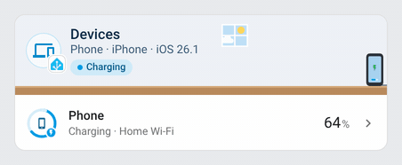 | 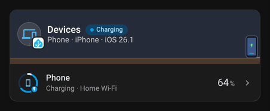 |

Low battery, the red arc blinks and a halo pulses out of the ring:

| Dark | Light |
|---|---|
| 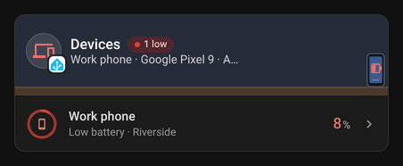 | 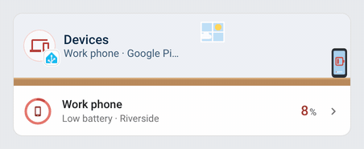 |

### Cards

Every Companion app device, one row each: a car head unit without battery, a MacBook, a charging iPhone, an iPad not seen for two days and an Android phone low on battery:

| Light | Dark |
|---|---|
|  |  |

A row unfolded by a click, with its details, **Ring device** and **Details**:

| Dark | Light |
|---|---|
| 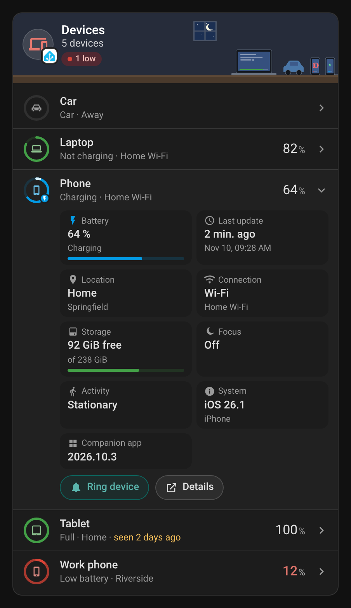 | 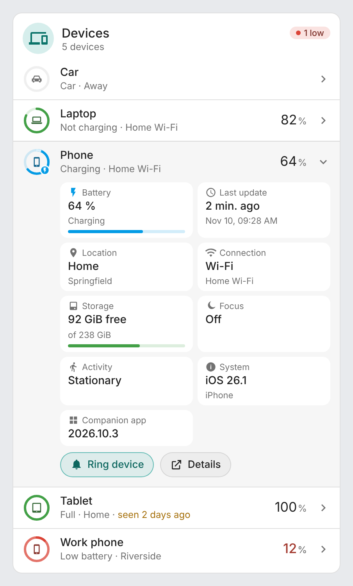 |

A single device is unfolded by default: an Android phone (battery health and temperature, power save, cellular, ringer, Do Not Disturb, activity, screen) and a MacBook (in use, displays, frontmost app, camera and microphone):

| | Android | macOS |
|---|---|---|
| Light | 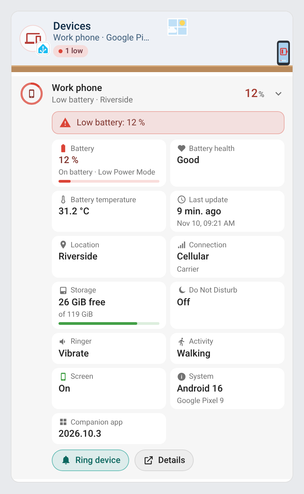 | 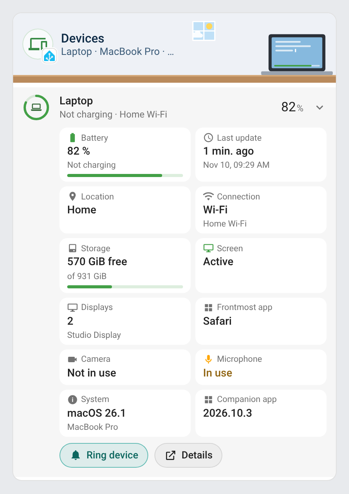 |
| Dark | 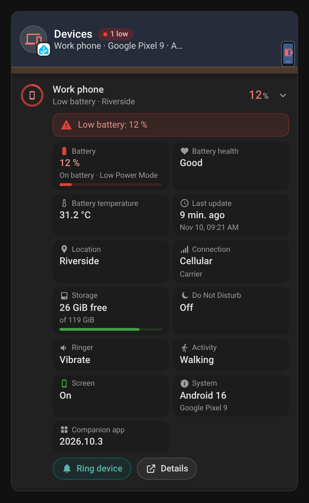 | 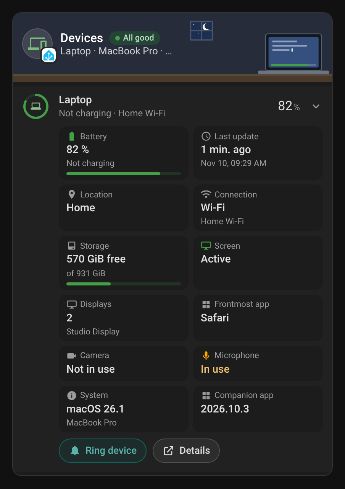 |

**Ring device** asks first, in a popup at the top of the card:

| Light | Dark |
|---|---|
| 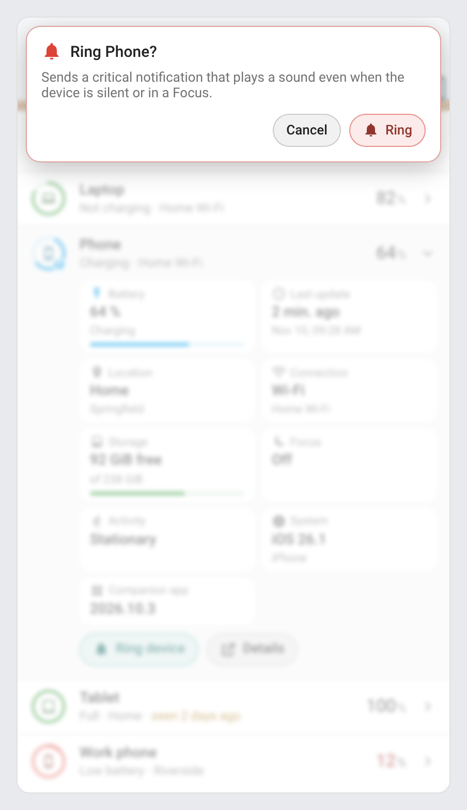 | 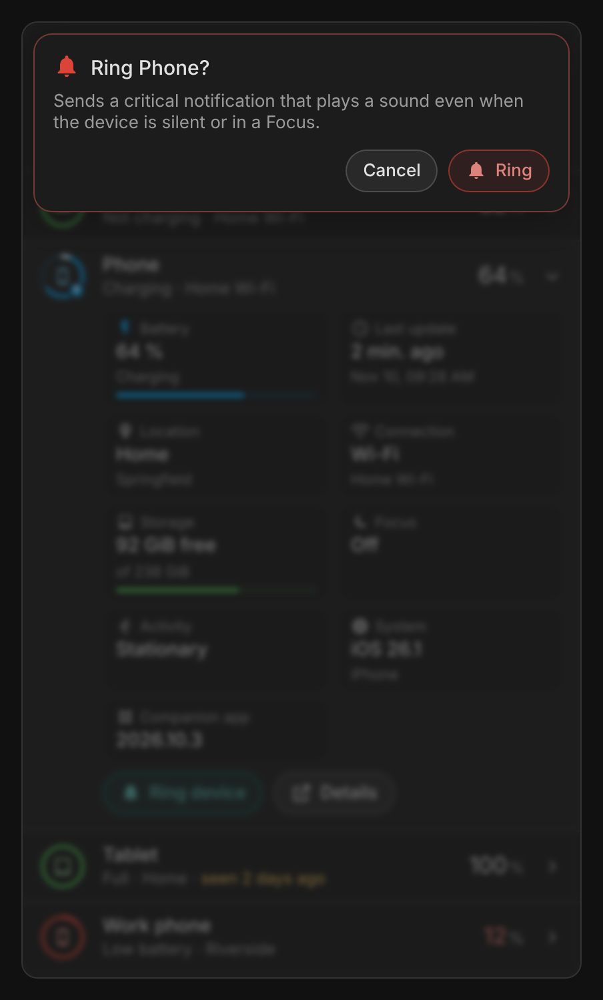 |

The mini card, and its detailed view after a click on the detail button:

| Light | Dark |
|---|---|
|  | 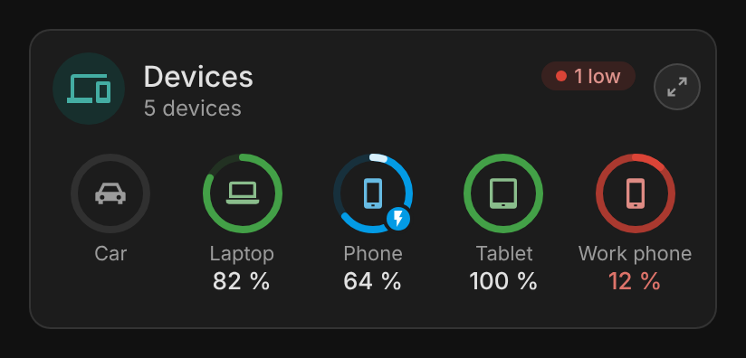 |
| 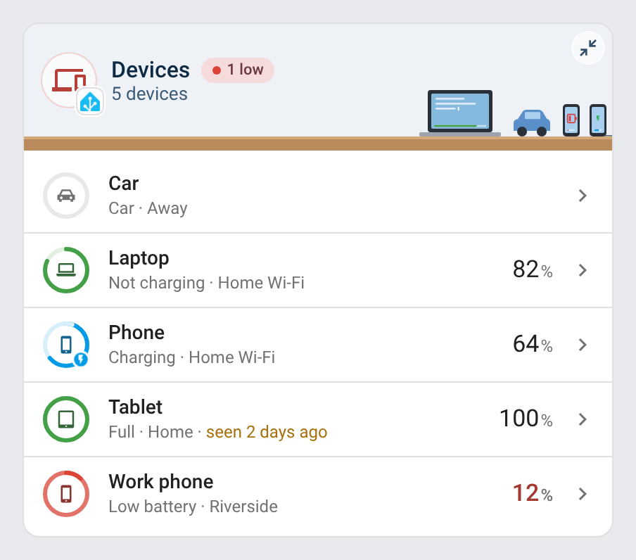 | 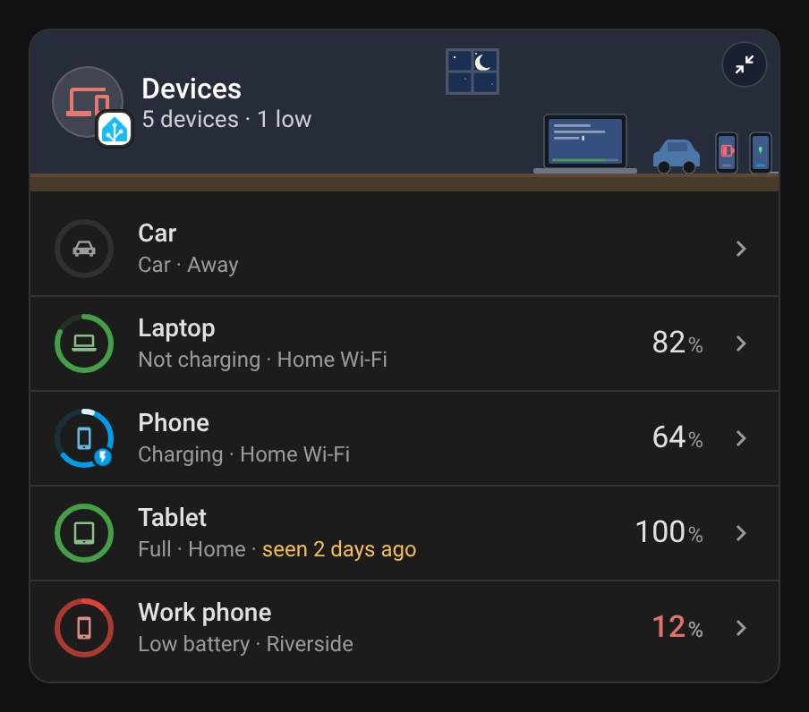 |

Narrow widths: the full card at 238 px (the line cut) and the mini card at 170 px (the status pill keeps its dot):

| | Full card | Mini card |
|---|---|---|
| Light | 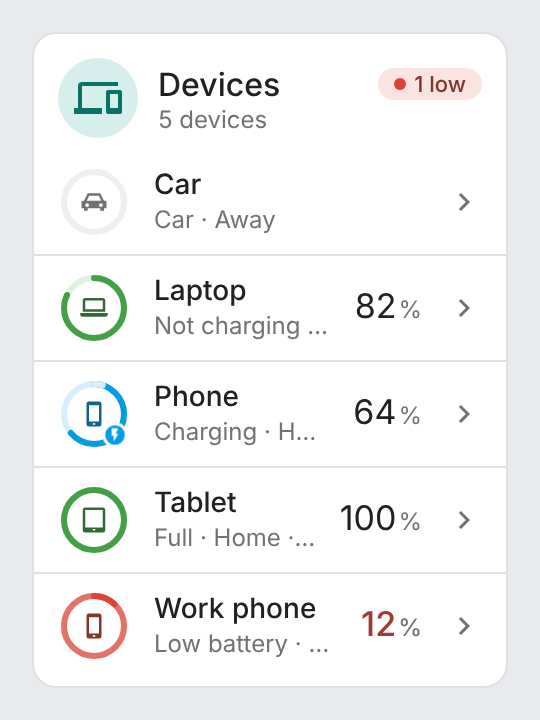 | 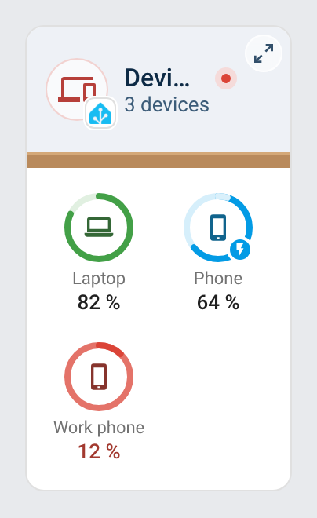 |
| Dark | 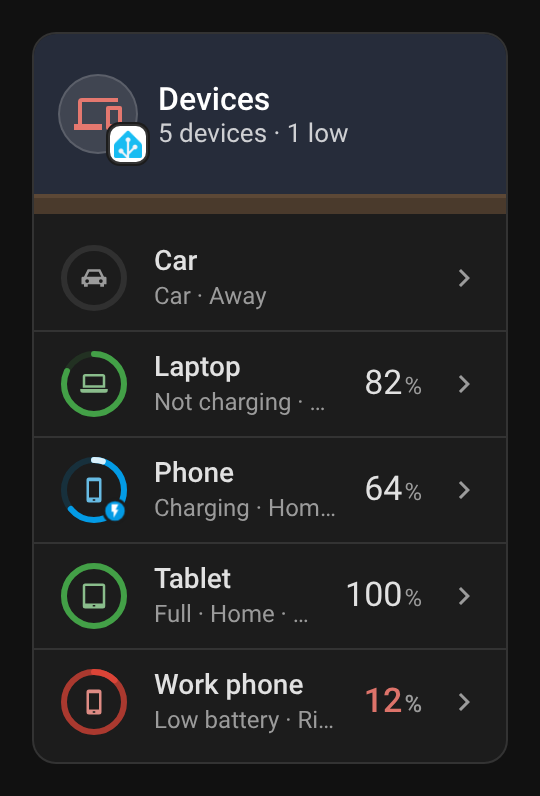 | 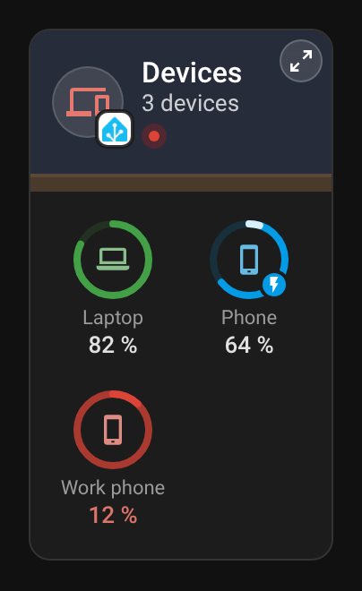 |

## How it works

The cards read the Home Assistant entity and device registries: every entity of the `mobile_app` platform belongs to a device, and the sensor it stands for is read from the end of its entity id after the device's name (`sensor.phone_battery_level` → battery level), else from its friendly name, else from the end of a renamed entity id. The apps write these names in English whatever the language, so the cards work in any language; a sensor still not found can be given in `entities`.

### Battery and state

The level is the battery level sensor, else the level the app reports with the device tracker. The state comes from the battery state sensor (iOS `Charging`, `Full`, `Not Charging`; Android `charging`, `discharging`, `full`, `not_charging`), else the charging binary sensor, else the charger type. A device not charging at or under `low_battery` reads **Low battery**.

| Ring | State |
|---|---|
| green | on battery, full, not charging |
| blue, animated | charging |
| red, pulsing | low battery |
| grey, empty | no battery (a car, a desktop) |

### Last update

The last update of a device is the latest update of any of its entities. Past `stale_after` hours it reads **seen … ago** in its row and counts as offline in the status pill.

### Ring device

The ring is sent through the device's legacy notify service, `notify.mobile_app_<device name>` (or the `notify` option): on iOS and macOS a **critical** notification (`push.sound.critical: 1`, `interruption-level: critical`), heard in silent mode and through a Focus once critical alerts are allowed; on Android a high priority notification on the **alarm stream** (`channel: alarm_stream`), heard in silent mode. The button only shows when the service exists.

## Development

```bash
npm install
npm run build        # bundles src/device-card.js into dist/device-card.js (translations split into dist/device-card.i18n.*.js)
npm run check        # builds and checks the card (run in CI)
npm test             # unit tests (node --test)
npm run screenshots  # renders the cards (and one GIF per animation, needs ffmpeg) with mock data into screenshots/
```

The source is split into ES modules under `src/` (entry `src/index.js`); `npm run build` assembles them (`scripts/bundle.mjs`) into the single file the Marketplace serves.

`dist/` is not committed: `npm run build` creates it locally, CI builds it on every push, and the release workflow attaches the built files to the release, which is where the Marketplace installs it from. The **Screenshots** workflow re-renders the captures on every pull request that touches the card and commits them to the pull request's branch when a pixel changed.

### Releasing

1. Bump `version` in `package.json` (and `package-lock.json` with `npm install`)
2. Add a `## <version>` section at the top of [CHANGELOG.md](https://github.com/juju35/ha-device-card/blob/main/CHANGELOG.md)
3. Push to `main`: the **Release** workflow builds the card, creates the tag and the GitHub release with the changelog section as notes, and attaches `device-card.js` and its translation files

## Translations

The cards auto-detect the language from your Home Assistant settings. Currently supported:

| Language | Code |
|---|---|
| English | `en` |
| Français | `fr` |
| Deutsch | `de` |
| Español | `es` |
| Italiano | `it` |
| Nederlands | `nl` |
| Português (European; also used for `pt-BR`) | `pt` |
| Polski | `pl` |
| Српски | `sr` |
| Srpski (latinica) | `sr-Latn` |
| Română | `ro` |
| Dansk | `da` |
| Svenska | `sv` |
| Български | `bg` |
| Русский | `ru` |
| Українська | `uk` |
| Magyar | `hu` |
| Slovenčina | `sk` |
| Čeština | `cs` |
| Slovenščina | `sl` |
| Latviešu | `lv` |
| Ελληνικά | `el` |

Contributions for additional languages are welcome!

## Credits

The Home Assistant logo comes from the [Home Assistant brands](https://github.com/home-assistant/brands) repository. iPhone, iPad, Mac and macOS are trademarks of Apple Inc.; Android is a trademark of Google LLC. This project is not affiliated with Apple or Google.

## License

[MIT](https://github.com/juju35/ha-device-card/blob/main/LICENSE)

## Support

If you find this project useful, you can support its development:

<a href="https://buymeacoffee.com/julienstep9"></a>
